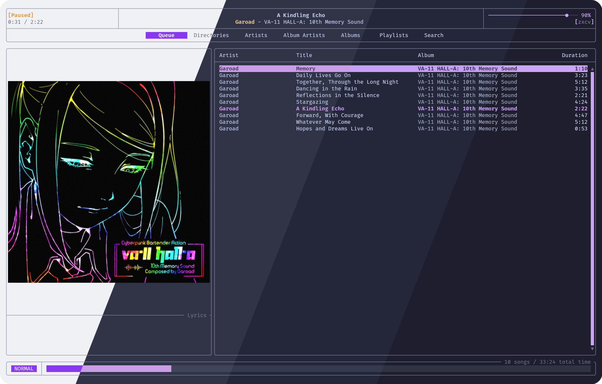
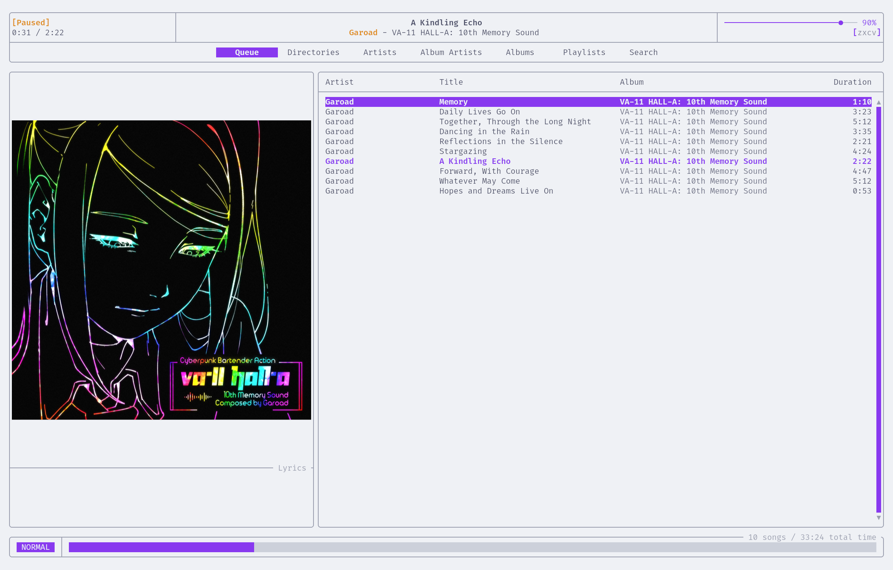
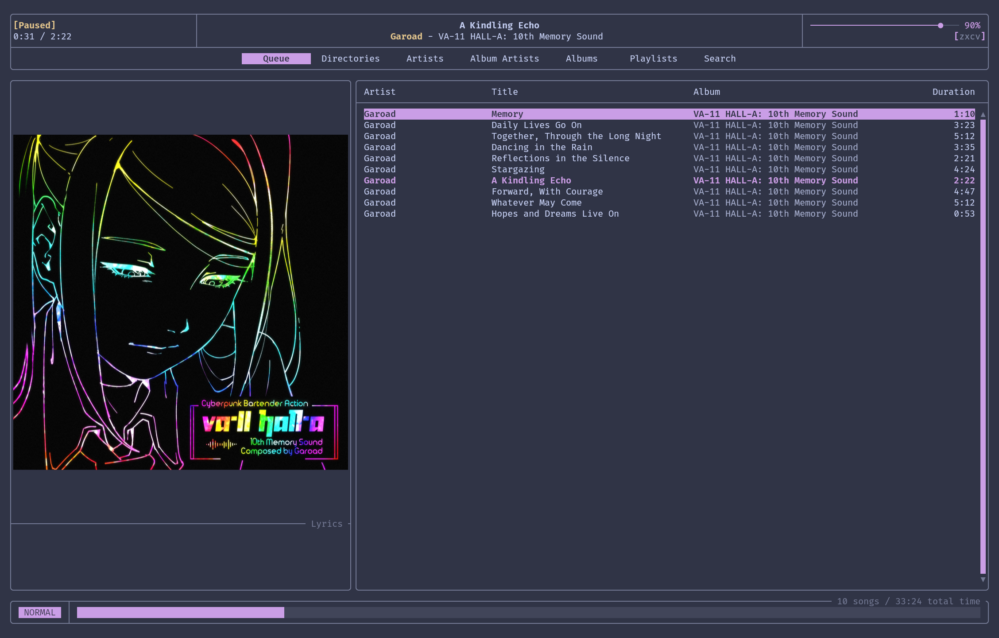
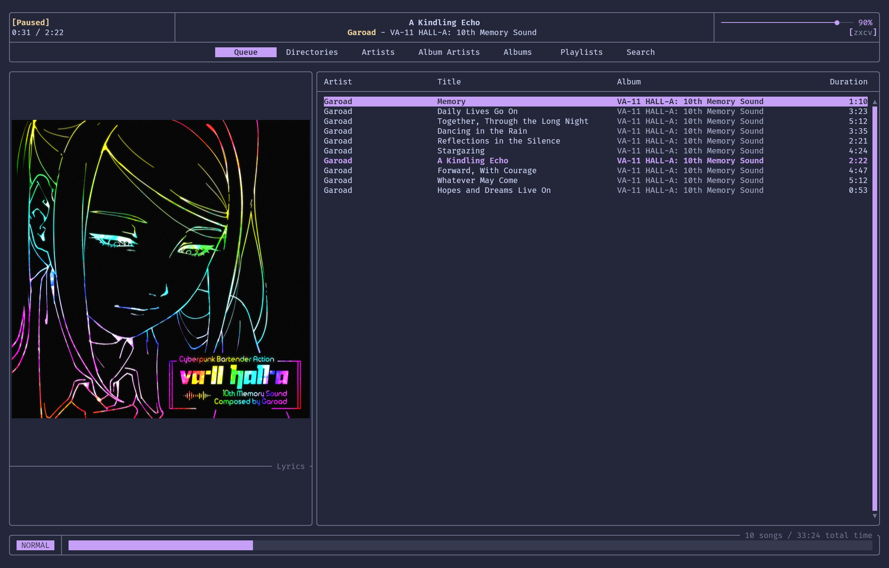
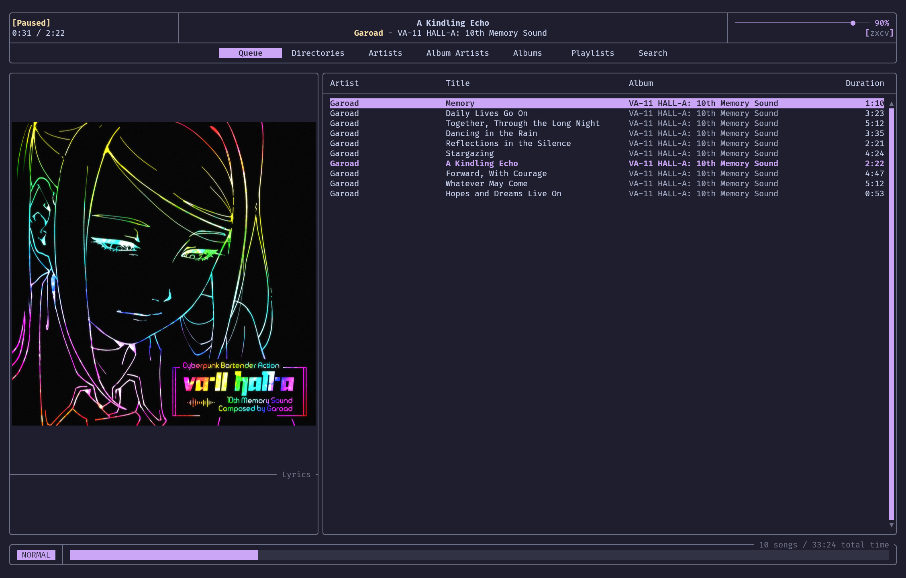

<h3 align="center">
	<br/>
	
	Catppuccin for <a href="https://github.com/mierak/rmpc">rmpc</a>
	
</h3>

<p align="center">
	<a href="https://github.com/catppuccin/rmpc/stargazers"></a>
	<a href="https://github.com/catppuccin/rmpc/issues"></a>
	<a href="https://github.com/catppuccin/rmpc/contributors"></a>
</p>

<p align="center">
	
</p>

## Previews

<details>
<summary>🌻 Latte</summary>

</details>
<details>
<summary>🪴 Frappé</summary>

</details>
<details>
<summary>🌺 Macchiato</summary>

</details>
<details>
<summary>🌿 Mocha</summary>

</details>

## Usage

Themes are named `catppuccin-<flavor>-<accent>`, with flavors `latte`, `frappe`, `macchiato`, `mocha` and the 14 Catppuccin accents (`rosewater`, `flamingo`, `pink`, `mauve`, `red`, `maroon`, `peach`, `yellow`, `green`, `teal`, `sky`, `sapphire`, `blue`, `lavender`).

1. Copy the theme of your choice from [`themes/`](./themes) to `~/.config/rmpc/themes/`.
2. Set it in your `config.ron`, without the extension:

   ```ron
   theme: Some("catppuccin-mocha-mauve"),
   ```

To try a theme without touching the config, point rmpc at the file directly:

```sh
rmpc --theme themes/mocha/catppuccin-mocha-mauve.ron
```

The themes only change colors. Layout, symbols and components are the same as rmpc's default theme, so they combine with any `config.ron`.

## Development

The themes are generated from [`rmpc.tera`](./rmpc.tera) with [Whiskers](https://github.com/catppuccin/whiskers). Edit the template, then run:

```sh
just build
```

## 💝 Thanks to

- [8098](https://github.com/KokaKiwi)

&nbsp;

<p align="center">
	
</p>

<p align="center">
	Copyright &copy; 2021-present <a href="https://github.com/catppuccin" target="_blank">Catppuccin Org</a>
</p>

<p align="center">
	<a href="https://github.com/catppuccin/catppuccin/blob/main/LICENSE"></a>
</p>
